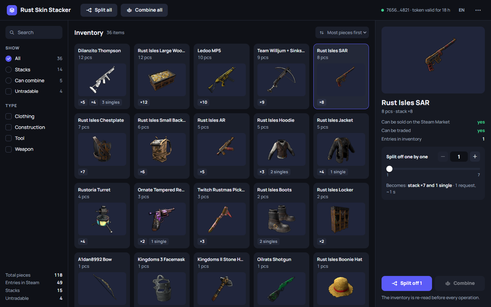
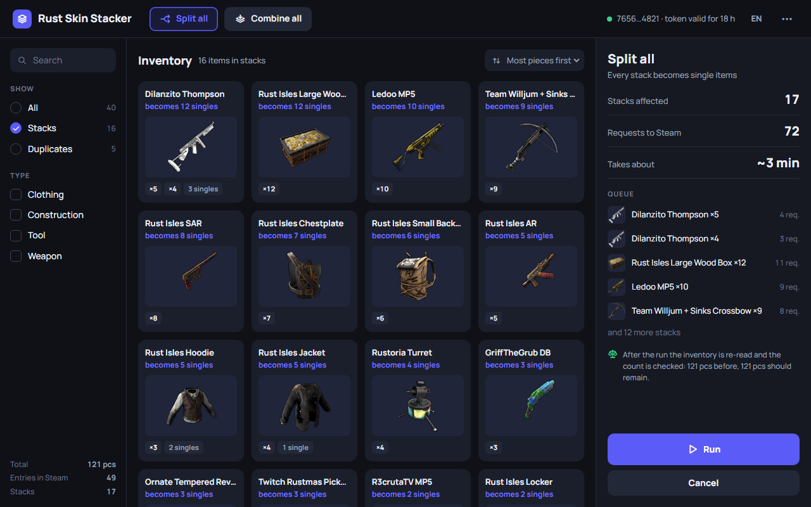

# Rust Skin Stacker

Split and combine stacks of Rust skins in your Steam inventory. Open source, runs on your computer, for Windows and Linux.

> Not affiliated with Valve or Facepunch. Use at your own risk.



Steam puts identical Rust skins into one inventory entry — "8 × Outlaw Revolver". To sell or trade them one by one, the stack has to be split, and sometimes you want them back in one stack. Rust Skin Stacker does both. It shows the plan before it starts and checks the count of every item afterwards.

## What it does

- **Split all** — every stack becomes single items.
- **Combine all** — identical items go back into one stack.
- **Split off N** — take N single items out of a stack, the rest stays a stack.
- **Selected items** — split or combine only what you picked (Ctrl + click, Shift + click).
- Handles inventories of thousands of items. English and Russian.



*Item names and pictures in the screenshots are real, quantities are made up.*

## Download

Get the latest version on the **Releases** page of this repository:

| System | File |
|---|---|
| Windows 10/11 | `…_x64-setup.exe` (installer) or `…_x64_en-US.msi` |
| Linux | `….AppImage`, `….deb` or `….rpm` |

All Linux builds, the AppImage included, need glibc 2.39 or newer: Ubuntu 24.04+, Debian 13+, Fedora 40+.

**Windows SmartScreen** may say the app comes from an unknown publisher: the builds are not code-signed, because a certificate costs money every year. Check the file as described below, then click *More info → Run anyway*.

## Get a token

Instead of your password, the app uses a temporary Steam token.

1. In a browser where you are signed in to Steam, open <https://steamcommunity.com/pointssummary/ajaxgetasyncconfig>. The app has a button for it.
2. Select everything on the page and copy it: Ctrl+A, then Ctrl+C.
3. Paste it into the app. The app finds the token itself and shows which account it belongs to and how long it lasts (about a day).

Do not share the token: until it expires, anyone who has it can act on your account. Never paste it into issues.

## Why you can trust it

- **The token stays in memory.** It lives in the app's Rust core, is never written to disk and never goes back to the window. Close the app and it is gone.
- **Only Steam.** The core talks only to `api.steampowered.com`. The window may load only item pictures from Steam's CDN; the Content Security Policy blocks everything else. No telemetry, no auto-update, no third-party servers.
- **The plan comes first.** Before a run the app shows how many stacks and requests it takes, re-reads the inventory and shows a new plan if something changed.
- **The result is checked.** After a run the app re-reads the inventory and compares the count of every item before and after.
- **Open code, builds on GitHub Actions.** Releases are built from this repository. Every file comes with a provenance attestation and is listed in `SHA256SUMS`.

### Check a downloaded file

```bash
# checksum (Linux; on Windows run Get-FileHash <file> and compare with SHA256SUMS)
sha256sum -c SHA256SUMS --ignore-missing

# provenance: the file was built by GitHub Actions from this repository
gh attestation verify <file> --repo <owner>/rust-skin-stacker
```

The second command needs the [GitHub CLI](https://cli.github.com/), signed in with `gh auth login`. `<owner>` is the account in the address of this page. The release notes have the exact command.

## How a run works

- Splitting a stack of A items takes A−1 requests to Steam. "Split off N" takes N requests.
- Combining moves entries of one item into its largest entry. Entries with a different trade status (another `instanceid`) are combined into a stack of their own.
- Requests go one at a time with a pause: 1.5 s by default, 0.5–10 s in Settings. If Steam asks to slow down, the app waits and shows a countdown.
- A run stops after three failures in a row, when Steam stops accepting the token, or when you press Stop (after the current request).
- Steam sometimes merges split items back. Running Split all again is normal.

## Build from source

You need Rust 1.90+, Node.js 22.12+ and the [Tauri prerequisites](https://v2.tauri.app/start/prerequisites/) for your system.

```bash
npm ci
npm run tauri build
```

Installers appear in `src-tauri/target/release/bundle/`.

For development, `npm run tauri dev` opens the app. `npm run dev` serves the window at http://localhost:1420 for a regular browser, with made-up data instead of Steam; it does not open the browser itself. Demo states: `?demo=main`, `?demo=item`, `?demo=plan`.

Tests: `npm test`, then `npm run build` and `cargo test --manifest-path src-tauri/Cargo.toml` — the Rust tests need the built `dist/` folder.

## License

[GPL-3.0](LICENSE). Rust is a trademark of Facepunch Studios, Steam is a trademark of Valve Corporation. This project is not affiliated with either.

[Русская версия](README.ru.md)
