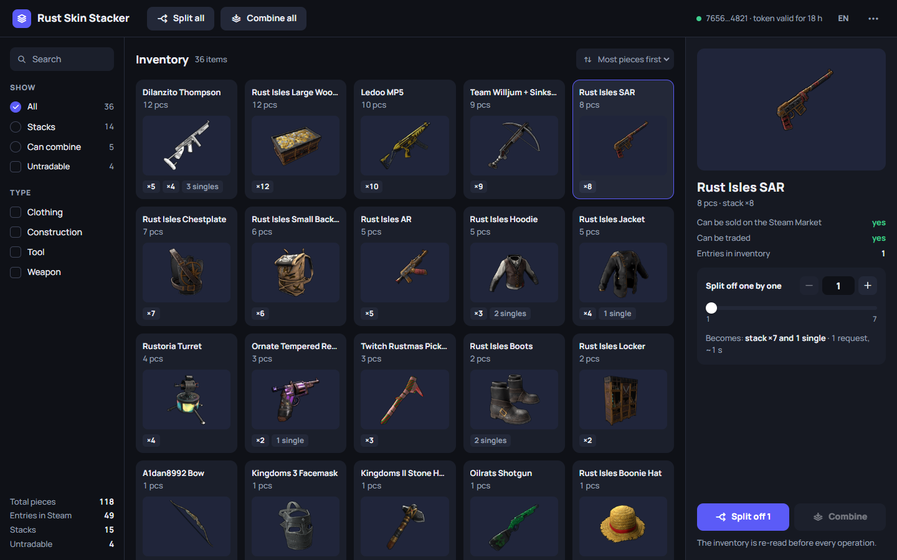
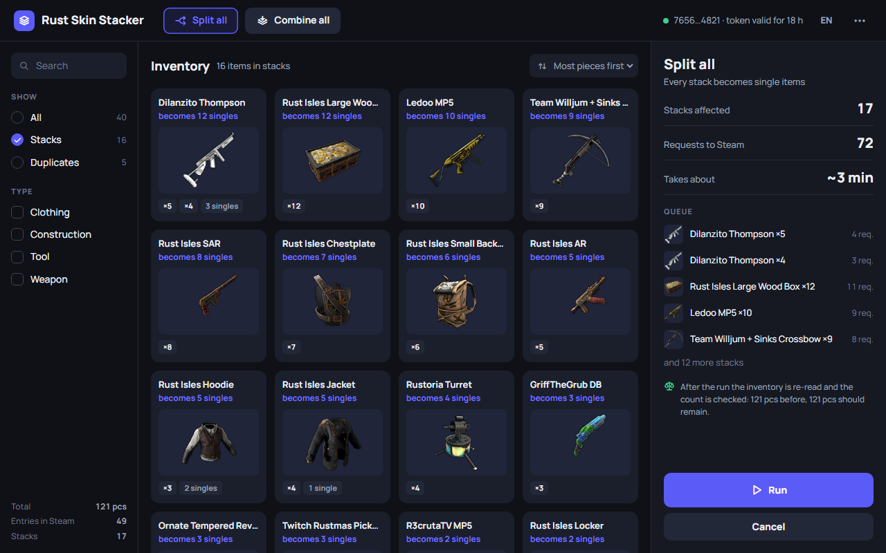

# Rust Skin Stacker

Делит и собирает стопки скинов Rust в инвентаре Steam. Открытый код, работает на вашем компьютере, есть версии для Windows и Linux.

> Не связано с Valve и Facepunch. Пользуйтесь на свой риск.



Steam складывает одинаковые скины Rust в одну запись инвентаря, например «8 × Outlaw Revolver». Чтобы продавать или обменивать их по одному, стопку нужно разделить, а иногда — собрать обратно. Rust Skin Stacker умеет и то и другое. До запуска он показывает план, а после операции сверяет количество каждого предмета.

## Что умеет

- **Разделить всё** — каждая стопка станет отдельными предметами.
- **Собрать всё** — одинаковые предметы снова лягут в одну стопку.
- **Отделить N** — достать из стопки N отдельных предметов, остальное останется стопкой.
- **Выбранное** — разделить или собрать только то, что вы отметили (Ctrl + клик, Shift + клик).
- Справляется с инвентарями на тысячи предметов. Интерфейс на русском и английском.



*Названия и картинки на снимках настоящие, количества выдуманы.*

## Скачать

Последняя версия — на странице [**Releases**](https://github.com/apposumlive/rust-skin-stacker/releases) этого репозитория:

| Система | Файл |
|---|---|
| Windows 10/11 | `…_x64-setup.exe` (установщик) или `…_x64_en-US.msi` |
| Windows 10/11, без установки | `…_x64-portable.exe` |
| Linux | `….AppImage`, `….deb` или `….rpm` |

Версия без установки запускается из любой папки. Ей нужен WebView2 от Microsoft: в Windows 11 он встроен, в Windows 10 ставится вместе с Edge. Её настройки хранятся в `%APPDATA%\io.rustskinstacker.desktop`.

Всем сборкам для Linux, и AppImage тоже, нужна glibc 2.39 или новее: Ubuntu 24.04+, Debian 13+, Fedora 40+.

**SmartScreen в Windows** может предупредить, что издатель неизвестен. Это потому, что сборки не подписаны сертификатом: он стоит денег каждый год. Проверьте файл, как описано ниже, и нажмите «Подробнее → Выполнить в любом случае».

## Как получить токен

Вместо пароля приложению нужен временный токен Steam.

1. В браузере, где вы вошли в Steam, откройте <https://steamcommunity.com/pointssummary/ajaxgetasyncconfig>. В приложении для этого есть кнопка.
2. Выделите всё на странице и скопируйте: Ctrl+A, затем Ctrl+C.
3. Вставьте в приложение. Оно само найдёт токен и покажет, от какого он аккаунта и сколько ещё действует (около суток).

Никому не передавайте токен: пока он не истёк, с ним можно действовать от вашего аккаунта. Не вставляйте его в issue.

## Почему этому можно доверять

- **Токен живёт только в памяти.** Он хранится в Rust-ядре приложения, не пишется на диск и не возвращается в окно. Закрыли приложение — токена больше нет.
- **Только Steam.** Ядро обращается только к `api.steampowered.com`. Окну разрешено загружать лишь картинки предметов с CDN Steam, остальное запрещает политика безопасности (CSP). Телеметрии, автообновления и сторонних серверов нет.
- **Сначала план.** Перед запуском приложение показывает, сколько стопок и запросов понадобится. Потом перечитывает инвентарь и, если что-то изменилось, показывает новый план.
- **Результат проверяется.** После операции инвентарь перечитывается, и количество каждого предмета сравнивается с тем, что было.
- **Открытый код, сборки на GitHub Actions.** Релизы собираются из этого репозитория. К каждому файлу приложено подтверждение происхождения, все файлы перечислены в `SHA256SUMS`.

### Как проверить скачанный файл

```bash
# контрольная сумма (Linux; в Windows выполните Get-FileHash <файл> и сравните с SHA256SUMS)
sha256sum -c SHA256SUMS --ignore-missing

# происхождение: файл собран в GitHub Actions из этого репозитория
gh attestation verify <файл> --repo apposumlive/rust-skin-stacker
```

Для второй команды нужен [GitHub CLI](https://cli.github.com/), в котором выполнен вход: `gh auth login`.

## Как идёт операция

- Чтобы разделить стопку из A предметов, нужно A−1 запросов к Steam. «Отделить N» — это N запросов.
- При сборке записи одного предмета переносятся в его самую большую запись. Записи с другим статусом обмена (другой `instanceid`) собираются в отдельную стопку.
- Запросы идут по одному с паузой: по умолчанию 1,5 с, в настройках — от 0,5 до 10 с. Если Steam просит подождать, приложение ждёт и показывает отсчёт.
- В настройках есть и масштаб интерфейса: по умолчанию «Авто» (подбирается по высоте экрана: на экране высотой 1440 px — 125%) или от 100 до 150%. Ctrl+= и Ctrl+− меняют его, Ctrl+0 возвращает «Авто».
- Если Steam отказывается делить или собирать стопку, приложение пропускает остаток этой стопки и идёт дальше.
- Операция останавливается после трёх неудач подряд (отклонённая стопка считается за одну), когда Steam перестаёт принимать токен, или по кнопке «Остановить» — после текущего запроса. Чтение инвентаря «Остановить» обрывает сразу.
- Иногда Steam снова склеивает разделённые предметы. Запустить «Разделить всё» ещё раз — нормально.

## Сборка из исходников

Нужны Rust 1.90+, Node.js 22.12+ и [системные зависимости Tauri](https://v2.tauri.app/start/prerequisites/).

```bash
npm ci
npm run tauri build
```

Установщики появятся в `src-tauri/target/release/bundle/`.

Для разработки: `npm run tauri dev` открывает приложение. `npm run dev` запускает окно на http://localhost:1420 для обычного браузера, с выдуманными данными вместо Steam; сам браузер он не открывает. Демо-данные: `?demo=main`, `?demo=item`, `?demo=plan`.

Тесты: `npm test` и `cargo test --manifest-path src-tauri/Cargo.toml`.

## Лицензия

[GPL-3.0](LICENSE). Rust — товарный знак Facepunch Studios, Steam — товарный знак Valve Corporation. Проект не связан ни с одной из этих компаний.

[English version](README.md)
